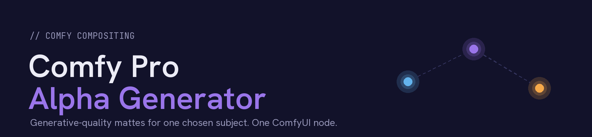
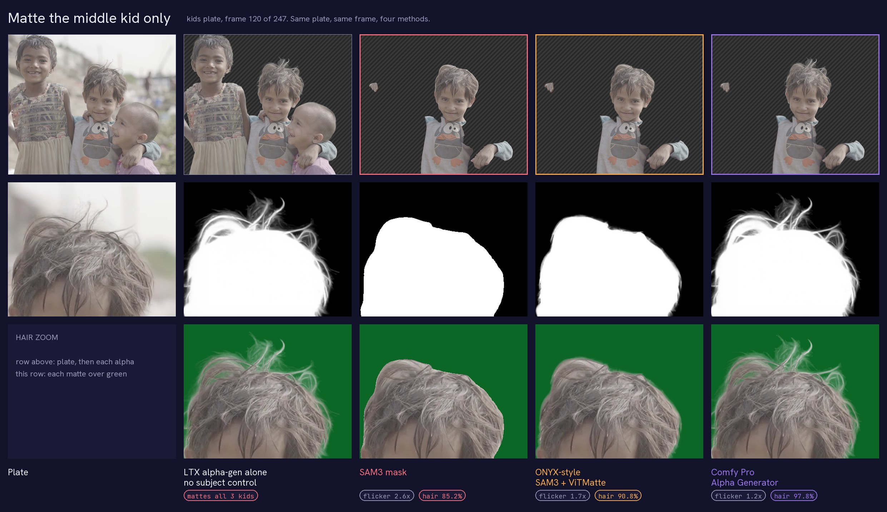
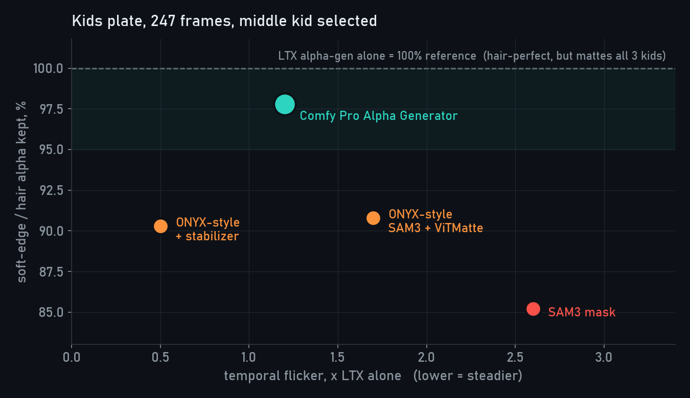
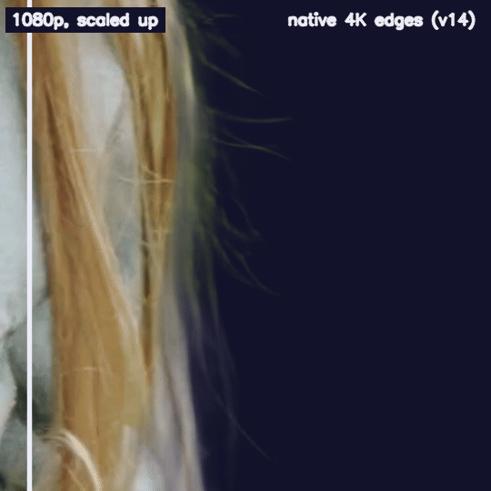
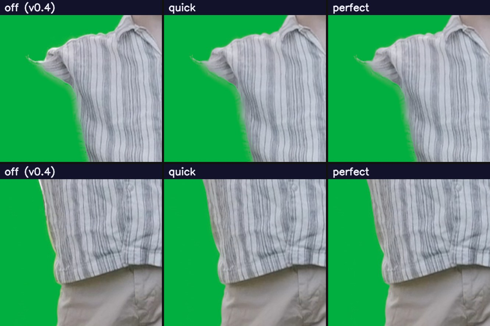
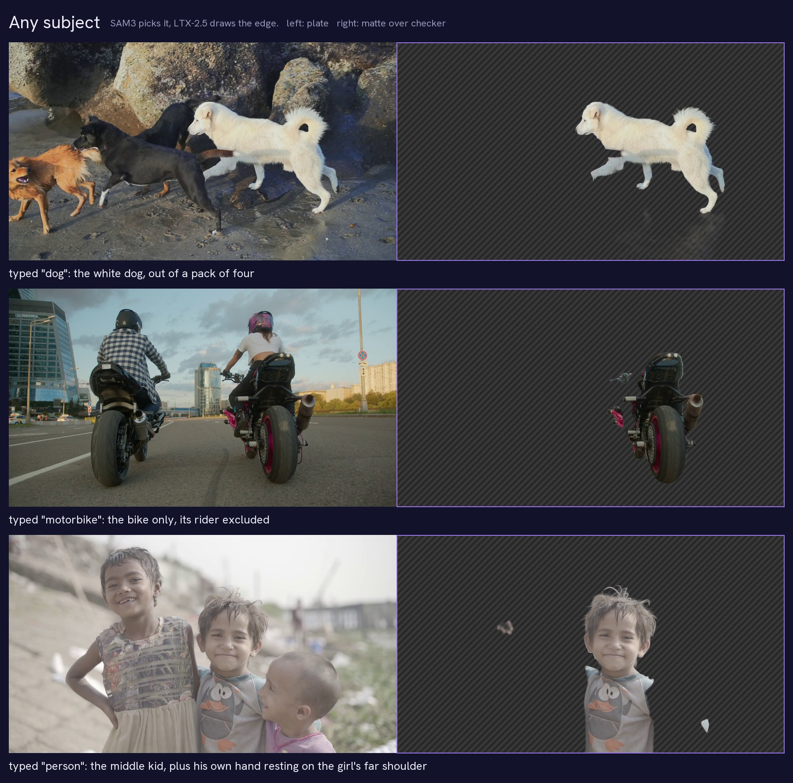
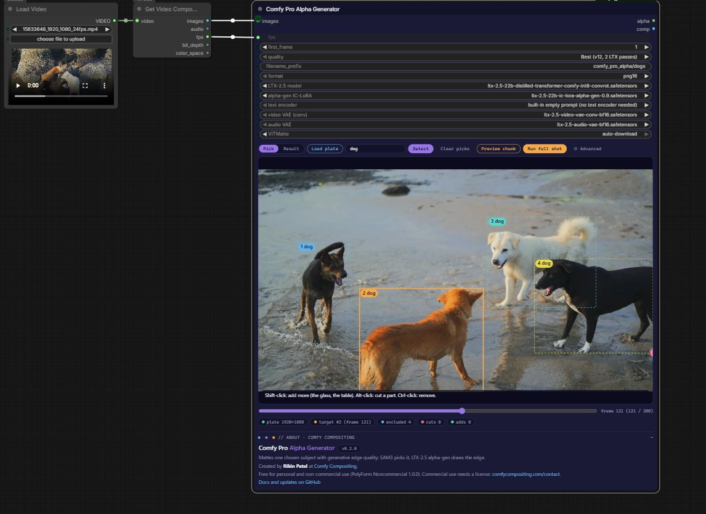
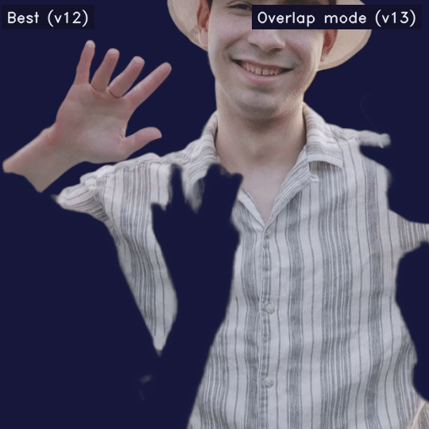
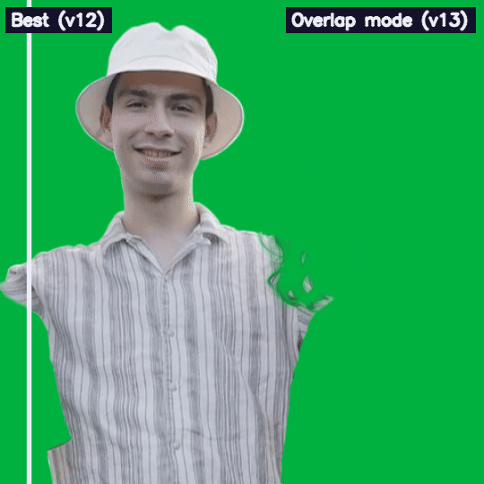
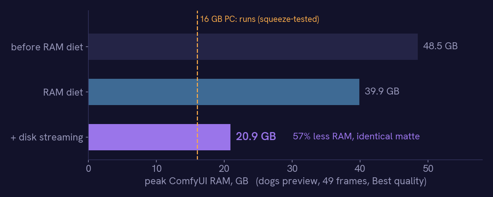

<div align="center">



by **Rikin Patel** · [Comfy Compositing](https://comfycompositing.com)

SAM3 decides *what* to matte. LTX-2.5 alpha-gen decides *how the edge looks*.


</div>



<sub>Task: matte the middle kid only. **LTX alpha-gen alone** has perfect hair but mattes all three kids, and there is no way to tell it which one. **SAM3** and **ONYX-style** pick the right kid but lose the strands. **Comfy Pro Alpha Generator** does both. Top: matte over checker. Below: hair zoom as alpha, then comped over green.</sub>

---

<sub><code>// 01 · problem</code></sub>

## The problem

Pulling one person out of a busy plate is still one of the most manual jobs in compositing. The AI tools I tried
fall into two groups, and each gets half of it right:

| | Picks *which* subject | Edge quality | Why |
|---|:---:|:---:|---|
| **LTX-2.5 alpha-gen** (generative) | no | hair-level | Renders the matte jointly over the whole clip, but mattes *every* main subject and can't be told which one. |
| **SAM3 / ONYX-style** (discriminative) | yes | soft, per-frame | Tracks any object you point at, then *measures* the edge frame by frame with ViTMatte. Strands get lost; edges chatter. |
| **Comfy Pro Alpha Generator** | **yes** | **hair-level** | SAM3 picks the subject, LTX draws the edge. |

<sub><code>// 02 · results</code></sub>

## Results

Measured on a 247-frame plate (three kids, arms around each other), matting only the middle kid.
Every method gets the same SAM3 selection.

<p align="center"></p>

| Method | Selects one subject | Edge detail match | Hair outside the SAM3 outline | Flicker vs LTX alone |
|---|:---:|:---:|:---:|:---:|
| LTX alpha-gen alone | no (mattes everyone) | 100% *(reference)* | 100% | 1.0x |
| SAM3 mask | yes | 29.4% | 0% | 2.6x |
| ONYX-style: SAM3 + ViTMatte | yes | 45.0% | 31.3% | 1.7x |
| ONYX-style + temporal stabilizer | yes | 46.1% | 31.8% | **0.5x** |
| **Comfy Pro Alpha Generator** | **yes** | **88.7%** | **88.7%** | 1.2x |
| Comfy Pro Alpha Generator, overlap mode (v13) | yes | 90.3% | 88.7% | 1.9x |

The edge matches LTX's generative hair at 88.7%, and only the middle kid is matted. The ViTMatte route gets to
45%: you get a soft halo around the head, but the strands are gone (compare the zoom at the top). A plain SAM3 mask
gets 29%.

Against the background, the node flickers about as much as LTX alone (0.0112 vs 0.0109 mean error per pixel). The
extra 0.2x comes from the few pixels where the kid touches someone else.

Overlap mode (v13) is for people crossing the subject; see [Settings guide](#settings-guide) for what it fixes and why it moves more.

The one row this node doesn't win: a stabilized ViTMatte matte is steadier than LTX itself (0.5x), because it is
smooth and has no strands left to move. That's the trade. I'll take a little more movement for real hair.

<details>
<summary><b>Methodology</b></summary>

- **Flicker** is motion compensated: each frame is predicted from its neighbours warped by DIS optical flow on the
  plate, and only the subject's outline band where the flow explains the plate (no occlusion) is scored. Plain
  frame-to-frame differences punish sharp edges that move, so they are not used.
- **Edge detail match** compares each matte with LTX's soft alpha (0.02 to 0.9) on the pixels nearer the subject
  than any other person: `1 - sum|matte - LTX| / sum(LTX)`. Filling in the gaps between strands and missing strands
  both count as error. **Hair outside the SAM3 outline** is the share of LTX's soft alpha beyond the SAM3 mask that
  a method recovers (a hard mask scores 0% by definition). Both use LTX as the reference, so they favour LTX-based
  methods; the hair zoom shows the same difference visually.
- An earlier version of this table used "hair kept", the plain sum of each matte over those pixels (SAM3 85.2%,
  ONYX-style 90.8%, this node 97.8%). It gave a solid mask credit for filling the gaps between strands, so it
  hid most of the difference and was replaced.
- **ONYX-style** is an emulation of ONYX Ai Matte v3's published pipeline (SAM3, then a trimap with erode 10 /
  dilate 15, then ViTMatte, per frame), plus this node's optical-flow stabilizer for the "+ stabilizer" row.
  The commercial ONYX plugin itself was not tested.
- Script: `measure_matte.py` logic, also built into the node as the QC badges.

</details>

### True 4K strand detail (v14)

<p align="center"></p>

<sub>UHD 4K plate, matte over navy. Left of the line: the 1080p matte scaled up to 4K. Right: native 4K edges.
More single strands, each thinner, and no grass baked into them.</sub>

Plates bigger than 1920x1088 are now matted at their own resolution. The node mattes a 1080p proxy exactly as before
(that pass decides what the subject is), then runs LTX alpha-gen again on native-resolution 1920x1088 tiles along the
subject's edge and merges them in. Fine hair, flyaways and fur keep single 4K strands instead of a soft 1080p band
scaled up. Tested on UHD 4K (3840x2160), DCI 4K (4096x2160) and 2K (2048x1080) plates.

| UHD 4K plate, long fine hair, RTX 5090 | 1080p scaled up (switch off) | **Native 4K edges** (on, default) |
|---|:---:|:---:|
| Edge flicker, frame to frame (lower = steadier) | 183 | **177** |
| Holes inside the subject | 0% | 0% |
| 49-frame preview | about 4 min, 20 GB RAM | about 9 min, 24 GB RAM |
| 242-frame shot | 19 min, 73 GB RAM | 58 min, 97 GB RAM |

It helps most on single strands, flyaways and fur against the background. Thick hair (braids) gains little. Where the
subject touches another person, the 1080p result is kept on purpose: a tile only sees part of the frame and decides
worse there. RAM grows with shot length (see [Hardware](#hardware)).

### Clean edge colour (v15)

<p align="center"></p>

<sub>Subject comped over green, 2x zoom. Off: the plate's own colour stays in the soft edge, so the sky behind the
sleeve shows as a white halo and the grass as a lime line down the shirt. Quick and perfect rebuild the subject's
colour there.</sub>

The alpha was right, but every soft edge still carried the background it was shot against: sky in the strands, grass
along the shirt. Over a new background that shows as a halo. v15 rebuilds the subject's own colour in the edge and
outputs a **clean premultiplied comp**, saved next to the alpha as `rgba_` files. The alpha itself does not change.

| Curls shot, 49 frames | Off (v0.4) | **Quick** (default) | Perfect |
|---|:---:|:---:|:---:|
| Background left in the edge (lower = cleaner) | 0.159 | **0.056** | 0.062 |
| Edge colour flicker (lower = steadier) | 0.064 | **0.021** | 0.028 |

- **Quick** works like an eroded EdgeExtend in Nuke: the colour comes from 2 px inside the subject and is pushed
  outward over the soft edge; the plate's brightness is kept for texture (stripes, strands), limited to the
  brightness range inside the subject so a white sky can't leak in. LTX edges often run a pixel wide, so even
  "solid" alpha there still holds background; quick cleans that rim too.
- **Perfect** also runs LTX-2.5 **Clean Plate**, which removes the people and rebuilds the background behind them,
  then subtracts that background from the edge (`F = (I - (1 - a) B) / a`). It is checked against the real plate
  and falls back to quick wherever the clean plate can't be trusted: next to other people, and on shots where the
  subjects fill the frame (Clean Plate then re-renders them instead of removing them). On a wide shot it gives a
  slightly tighter, more physical soft edge; on a close-up it gives the same result as quick, at the cost of one
  more LTX pass.

### Any subject

<p align="center"></p>

Type a word (`dog`, `red car`, `bike`) or click anything in the frame. The others are excluded automatically,
including the same class: the white dog out of four, the bike without its rider.

---

<sub><code>// 03 · method</code></sub>

## How it works


**How it gets there**

1. LTX can't be told which subject to matte, so the node changes what LTX *sees*. SAM3 finds every other subject,
   and they get painted out of a copy of the plate with an inpainted background. (A flat colour fill doesn't work:
   LTX reads it as a half-transparent object.) LTX then mattes the subject on its own and draws all of its edges,
   including parts SAM3 missed.
2. Where the subject overlaps another person, LTX outputs 1.0 on both sides, so there is no edge to take from it.
   Within about 15 px of other subjects the node uses the stabilized ViTMatte edge instead. Everywhere else the edge
   is LTX's.
3. LTX only mattes what it reads as a main subject. A coverage map (1/8 res, smoothed over time) finds the parts of
   the selection LTX left empty, like a parked car or a table, and fills only those with ViTMatte.
4. LTX renders 49 frames at once, so its edges hold still. SAM3 and ViTMatte decide frame by frame, so their output
   is smoothed with optical-flow-warped neighbours before the blend. Long shots render in overlapping chunks that are
   cross-faded, and the joins measure steadier than the rest of the shot.
5. On Queue, the node expands into a full ComfyUI graph of SAM3, ViTMatte and LTX stages. Each stage is cached, so
   switching Fast/Best, or running the full shot after a preview, reuses whatever already finished.

**Overlap mode (v13)** handles people crossing the subject, where step 2 can only give a ViTMatte edge. It keeps
the real plate and steers LTX with each SAM3 mask (the IC-LoRA guide's attention mask): one pass for the subject,
one for everyone else, then subtracts the others wherever SAM3 and a depth pass say they are in front. Their
fingers and curls get a generative edge too. Details in the [Settings guide](#settings-guide).

**Native-resolution edges (v14)** handle plates bigger than 1920x1088. Everything above runs on a 1080p proxy of the
plate. Then the plate is cut into native-resolution 1920x1088 tiles (half-overlapping), and only the tiles that touch
the subject's edge get their own LTX pass, with the other subjects painted out at full resolution. The merge keeps the
proxy result inside the subject, near other people, and wherever a tile disagrees with it over an area (a tile only
sees part of the subject, so its big decisions are worse); everywhere else the tiles supply the strands. Which tiles
are needed is only known once SAM3 has tracked the subject, so that stage expands into its LTX passes at run time.

<details>
<summary><b>Engineering notes</b></summary>

- LTX runs with Comfy Kitchen int8 attention. Sampling drops from 5.09 to 3.25 s/step (36% faster) and the edge
  moves by 0.004, seven times less than changing the seed does. I also tried Sage attention (same speed, but it needs
  a wheel built for each machine), Flash attention (no gain), block-sparse attention (changed the matte as much as a
  new seed) and torch.compile (crashes on the int8 weights).
- Alpha-gen uses an empty prompt, so the pack ships that conditioning (24 KB, captured inside ComfyUI so it is
  bit-identical). Nobody has to download the 13 GB text encoder or hold it in RAM.
- uint8 plates, float16 masks, an alpha-only VAE decode and per-frame blending took peak RAM from 48.5 to 39.9 GB.
  Disk streaming halves it again (see Hardware).
- I diffed every memory change against the previous output. One of them rounded the isolated plate's colours by a
  single 8-bit level, and LTX turned that into a visibly different sample (0.012 edge difference). Anything that
  feeds the generative pass now stays at full precision, and the mattes are identical again.

</details>

---

<sub><code>// 04 · usage</code></sub>

## Using it

<p align="center"></p>

The node walks you through three steps (**Plate → Subject → Render**) and only shows the next action.

1. Open `example_workflow.json` (video) or `example_sequence_workflow.json` (image sequence), or wire it yourself:

   | Plate | Wiring |
   |---|---|
   | **Video** | Load Video → Get Video Components → `images` + `fps` |
   | **Image sequence** | **Load Plate Sequence** → `images` + `fps` + `first_frame` |

   **Load Plate Sequence** reads a folder (`D:/plates/sh010`) or a pattern (`plate.####.exr` or `plate.%04d.exr`).
   PNG, JPG, TIF and EXR (scene-linear, converted to sRGB). `first` / `last` set the range, and output frames keep
   the plate's numbers: `plate.1001` gives `alpha_01001`.

   Any nodes can sit in between (crop, resize, colour). **Best quality at 1920x1088** (1920x1080 is padded
   automatically): LTX alpha-gen is tuned for that size. Bigger plates (4K, DCI, 2K) need nothing extra: the node
   mattes a 1080p proxy and renders the edges again at native resolution ([True 4K strand detail](#true-4k-strand-detail-v14)).

2. **Plate.** Click the big **Load plate** button. It runs the nodes feeding `images` and fills the scrubber.
3. **Subject.** Scrub to a frame where the subject is fully visible and **click it**. It turns orange; every other
   person or object the click finds is excluded. Shift-click more objects to add them: the man, his glass and the
   table give one matte. Hard to click? Type it in **Find** (top right of the viewer):

   | Type | Finds |
   |---|---|
   | `person` (default) | every person |
   | `dog`, `red car`, `bike`, `woman` | any SAM3 concept |
   | `dog, person` | both: also paints out the people near a dog |

4. Fix parts if needed, on the first frame the part appears (tracking runs forward):

   | Action | What it does |
   |---|---|
   | **Alt-click** | **Cut** a part: someone else's hand on the subject |
   | **Shift-click** | **Add** a part: the subject's own hand that SAM3 missed |
   | **Ctrl-click** | Remove a cut or add marker |

5. **Render.** **Preview 49 frames** first (a few minutes). The result opens on the alpha; drag to wipe it
   against the plate, **Show comp** for the comp.
6. **Render full shot.** The alpha is saved to `ComfyUI/output/<filename_prefix>/alpha_00001.png …`,
   16-bit PNG by default or half-float EXR.

| Mode | What it does |
|---|---|
| **Best (v12)** | 2 LTX passes, the second on the isolated plate. |
| **Fast (v7)** | 1 LTX pass. About half the time; edges against other subjects are a little weaker. |
| **handle overlapping people (v13)** | Switch below the models. 3 LTX passes plus depth, for hands, arms and hair crossing the subject. Replaces `quality` while on. |

**QC badges** (after each run)

| Badge | Meaning | Green when |
|---|---|---|
| flicker | Motion-compensated flicker vs LTX alone | ≤ 1.3x |
| detail match | How closely the edge matches LTX's hair, fur and dust | ≥ 80% |
| LTX cover | How much of the subject LTX matted (the rest uses ViTMatte) | ≥ 90% |

`⚙ Advanced`: frames per chunk, overlap frames, seed, temporal smoothing, trimap erode/dilate, the zone near other
subjects, SAM3 threshold, `fast_attention`, the optional text encoder and the v13 tuning. The
[Settings guide](#settings-guide) covers every one, with when to change it. Hover any model selector for the
recommended file and folder; press **R** after adding models. A missing model shows as `MISSING: <file>`, and the
run stops with the download link instead of failing halfway.

---

<sub><code>// 05 · settings</code></sub>

## Settings guide

Every setting, what it changes, and when to touch it. The defaults are the values that measured best on the test
shots, so **start with the defaults and change one thing at a time**. Re-rendering is cheap after the first run:
each stage is cached, so changing a late setting (format, the v13 options, temporal smoothing) reuses the LTX passes.

### Pick your mode first

| Your shot | Mode | Why |
|---|---|---|
| One person, nobody else near them | **Best (v12)** | Nothing to separate. Fast gives almost the same matte. |
| Several people, nobody touching or crossing the subject | **Best (v12)** | The others are painted out and LTX mattes the subject alone. |
| Look-dev, timing tests, lots of shots to triage | **Fast (v7)** | About half the time. Edges against other people are a little weaker. |
| Someone's hand, arm or hair **crosses in front of** the subject | **handle overlapping people (v13)** | Their fingers and curls get their own generative edge instead of a soft ViTMatte line. |
| The subject's arm is around someone, hands on shoulders, a hug | **v13**, plus an **add** click on the hand (see below) | v13 keeps the arm crisp over the other person. |
| A crowd behind the subject, nobody crossing them | **Best (v12)** | v13 costs a third LTX pass and only helps where people overlap. |
| A plate bigger than 1080p (4K, DCI, 2K) with fine hair, fur or flyaways | any mode, **native-resolution edges** on (default) | The strands are rendered at the plate's own resolution. Switch it off for a quick pass: the 1080p matte scaled up, 2 to 3x faster. |

### Overlap mode (v13)

<p align="center">


</p>

<sub>Matte the man in the striped shirt, comped over green. Left of the line is **Best (v12)**, right is **Overlap
mode (v13)**. **Fingers:** his friend's waving hand crosses his chest; v12 gives a soft blob with the shirt showing
through the fingertips, v13 cuts each finger out cleanly. **Hair:** her curls fall over his shoulder; v12 cuts his
shoulder off along a smooth line, v13 cuts her curls out of his shirt and keeps the shoulder underneath.</sub>

**What it does.** v12 paints the other people out and mattes the subject alone, so where someone crosses the
subject there is no generative edge, only a ViTMatte one. v13 keeps the real plate and runs three LTX passes:

| Pass | LTX is steered to | Gives |
|---|---|---|
| 1 | the whole plate | everyone together, used to clip the other two |
| 2 | the subject (its SAM3 mask as LTX's attention mask) | the subject, including the parts others hide |
| 3 | everyone else at once (their masks combined) | one matte of all the other people |

Then it subtracts pass 3 from pass 2 wherever the others are **in front**. SAM3 decides that where it sees only one
person; a depth pass decides where SAM3 gives a pixel to both people or to neither. The cost stays at 3 passes
however many people are in the shot (one pass per person measured the same).

**Measured.**

| Test | Best (v12) | Overlap mode (v13) |
|---|:---:|:---:|
| Overlap error on a synthetic clip with exact ground truth (her hair moved across his collar) | 105.6 | **21.5** (5x lower) |
| Kids shot, 247 frames: edge detail match | 88.7% | **90.3%** |
| Kids shot: flicker vs LTX alone (motion compensated) | **1.2x** | 1.9x |
| 49-frame preview, RTX 5090 | about 4 min | about 4.7 min |
| 247-frame shot, RTX 5090 | about 25 min | about 26.5 min |

The flicker rise comes from the overlap edges: sharp fingers and curls that move score as more movement than a soft
line that doesn't. Check it in motion on your shot. The synthetic ground truth was built from LTX mattes, so it
favours LTX-like edges.

**v13 settings** (always listed, greyed out until the switch is on):

| Setting | Default | What it does | Turn it... |
|---|:---:|---|---|
| **handle overlapping people (v13)** | off | Switches to the 3-pass overlap mode above and greys out `quality`. Needs at least one other person picked (they are found automatically when you click the subject); with nobody else it runs Best (v12). | **On** when anyone crosses the subject. |
| **use depth for front/back** | on | A small depth model (Depth Anything V2 Small, 99 MB, downloads itself) settles who is in front where SAM3 is unsure: thin, fast fingers over a chest, where SAM3's coarse masks give the pixels to both people. The answer is voted over about 25 px, so the palm carries the fingertips. | **Off** only to save a few seconds, or if you see a wrong front/back flip where SAM3's masks are clean. With it off, fast fingers in front of the subject can ghost. |
| **sharpen hair over subject** | off | Re-fits the other person's hair matte to the plate's own edges (a guided filter, plate brightness as the guide): more single strands, cleaner gaps between curls. | **On** for dark hair over a lighter subject (or the reverse) when the curls look soft or the gaps between them look grey. **Off** if the subject wears stripes, checks or a busy print: the filter can read dark stripes as hair and cut thin lines into the subject. |
| **sharpen hair radius (px)** | 4 | How far the filter looks for edges. Greyed out until sharpen is on. | **Lower (2 to 3)** for fine, separated strands. **Higher (6 to 8)** for thick curls or a noisy, compressed plate. Higher also picks up more clothing pattern. |

**Under ⚙ Advanced** (v13 tuning, also greyed out until the switch is on). These were swept on the test shots;
change them only to fix a specific problem:

| Setting | Default | What it does | When to change it |
|---|:---:|---|---|
| **v13 attention grow (px)** | 20 | Grows each SAM3 mask before it steers LTX, so hair beyond the SAM3 outline still gets matted. | **Raise to 30 to 40** if long or wild hair beyond the SAM3 outline is cut off. **Lower to 10** if the subject's matte picks up the edge of a person standing right next to them. |
| **v13 attention feather** | 10 | Softens that mask's edge. 0 = hard edge, which cut the hair (about 1.5x the error). | Leave at 10. Higher (15 to 20) only for very soft, flyaway hair. |
| **v13 attention strength** | 1.0 | How strictly LTX follows the mask. 0.7 measured about 1.3x the error. | Leave at 1.0. |
| **v13 occluder reach (px)** | 20 | How far past the overlap the subtraction reaches, to catch the soft edge of whoever is in front: strand tips, motion-blurred fingertips. | **Raise to 30 to 40** if the tips of someone's fingers or hair still show as a faint ghost over the subject. **Lower to 10** if the subject's own thin parts lying next to someone (fingers on a shoulder) get nibbled. |
| **v13 invented-limb cap (px)** | 90 | LTX draws parts of the subject it can't see; that's how it fills in behind others. Anything further than this from the subject's SAM3 mask is removed, fading over the last 40 px. Stops invented arms. | **Raise (150 to 250)** if real edges far from the SAM3 mask get cut: big hair, a scarf, a raised hand SAM3 missed (an add click is the better fix). **Lower (60)** if a faint extra limb or ghost appears beside the subject. |
| **v13 front/back smoothing (frames)** | 3 | Averages the front/behind decision over this many frames so it can't pop. | **Raise to 5** if an overlap edge flickers between in front and behind. **1** for very fast action where 3 frames lag behind a quick hand. |

**When something is wrong in v13:**

| You see | Cause | Fix |
|---|---|---|
| The subject's own hand or arm is missing where it rests on someone (an arm round a friend's neck) | SAM3 gave that limb to the other person, so v13 treats it as theirs and subtracts it. Depth can't help: the hand really is at the friend's depth. | **Shift-click (add)** the hand on a frame where it touches. One click fixed the hand in the kids test. |
| Someone else's hand appears **inside** the subject's matte | SAM3 gave their hand to the subject. | **Alt-click (cut)** their hand on the first frame it appears. |
| Ghosted, half-transparent fingers over the subject | The other person's fingertips aren't fully subtracted. | Keep **use depth** on, then raise **occluder reach** to 30. |
| Grey gaps between someone's curls over the subject | LTX draws their hair soft over a light background. | **Sharpen hair** on. |
| Thin dark lines cut into a striped or checked shirt | Sharpen hair is reading the stripes as hair. | Sharpen hair off, or **radius** down to 2. |
| A faint extra arm or blob next to the subject | A limb LTX invented. | Lower **invented-limb cap** to 60. |
| An overlap edge pops between frames | The front/behind decision flips. | **Front/back smoothing** to 5. |

**When something is wrong on a 4K plate:**

| You see | Cause | Fix |
|---|---|---|
| ComfyUI runs out of RAM on a long 4K shot | Every 4K frame is held in memory (97 GB at 242 frames with native edges, 73 GB without). | Split the shot into runs of about 100 frames (`first` / `last` on Load Plate Sequence, or trim the video), disconnect the node's `comp` output, or switch native edges off. |
| Edges against another person look 1080p-soft | By design: near other people the proxy result is kept. | Nothing to fix; those edges come from the proxy pass. |
| Thick hair looks the same on and off | Its edge is already resolved at 1080p. | Switch native edges off on that shot to save time. |

### All other settings

**Main**

| Setting | Default | What it does | When to change it |
|---|:---:|---|---|
| `images` | | The plate. Any chain works (crop, resize, colour). | Feed the plate at its own resolution. Up to 1920x1088 it is matted directly; bigger plates are matted on a 1080p proxy with native-resolution edges. Don't downscale a 4K plate yourself. |
| `fps` | 24 | Plate frame rate, passed to LTX. | Wire it from Get Video Components or Load Plate Sequence. Set it by hand only for loose images. |
| `first_frame` | 1 | Frame number of the first image; output files use it. | **1001** (or your plate's start) for VFX numbering. Load Plate Sequence sets it for you. |
| `quality` | Best (v12) | 2 LTX passes (Best) or 1 (Fast). Greyed out in v13. | Fast for look-dev and triage, Best for finals. |
| `native-resolution edges (v14)` | on | Plates bigger than 1920x1088: LTX renders the subject's edges again on native 1920x1088 tiles and merges them into the proxy matte. Works with every mode. Greyed out for plates of 1080p or less. | **Off** for a fast first look, when RAM is short on a long 4K shot, or on plates only a little over 1080p (2K): little extra detail there for the full tile cost. Off gives the 1080p matte scaled up, 2 to 3x faster. Leave it **on** for finals with fine hair, fur or flyaways. |
| `edge colour (v15)` | quick | Rebuilds the subject's colour in the soft edges so the background doesn't show through, and saves `rgba_` files (clean premultiplied comp) next to the alpha. **quick**: classical, a few seconds per frame. **perfect**: adds an LTX Clean Plate pass and subtracts the real background (needs the Clean Plate IC-LoRA). **off**: the raw plate in the edges, as v0.4. The alpha is identical in all three. | **perfect** for finals on wide shots where background shows around the subject. **off** only to reproduce a v0.4 render exactly. |
| `filename_prefix` | `comfy_pro_alpha/shot` | Output folder under `ComfyUI/output/`. | One per shot (`show/sh010_hero`) so renders don't overwrite each other. |
| `format` | png16 | 16-bit PNG or half-float EXR. | **exr** for a Nuke/EXR pipeline. Both hold the full soft edge. |
| model selectors | the recommended files | LTX model, alpha-gen IC-LoRA, Clean Plate IC-LoRA (perfect edge colour only; greyed out otherwise), video VAE (must be the **conv** VAE), audio VAE, ViTMatte. | Only to pick a GGUF (see [Hardware](#hardware)) or a file in another folder. `MISSING:` means the file isn't found. |

**⚙ Advanced**

| Setting | Default | What it does | When to change it |
|---|:---:|---|---|
| `text encoder` | built-in | The empty-prompt conditioning alpha-gen uses. | Never. The built-in one is bit-identical to running the 13 GB encoder. |
| `frames per chunk` | 49 | LTX renders the shot in chunks of this many frames (8n+1). | Keep 49 at 1080p (it fits a 32 GB GPU). **Lower (33 or 25)** if you run out of memory: more chunks means more joins and a slower render. |
| `overlap frames` | 9 | Frames shared by neighbouring chunks and cross-faded. | **Raise (17)** if you can see a jump where two chunks meet (every 40 frames at the defaults). Lower to save time on very long shots. |
| `seed` | 42 | LTX's noise seed. | Try another seed if one stretch shows a strange edge. It is a cheap second opinion: a new seed moves the edge about 0.03 on average. |
| `erode` / `dilate` | 10 / 15 | The ViTMatte trimap: how far inside / outside the SAM3 edge the "unknown" band reaches. Used where LTX leaves the selection empty (props, background objects) and, in v12, against other people. | **Raise dilate (25 to 30)** if ViTMatte cuts frizzy edges short. **Lower both (5 / 8)** if ViTMatte bleeds into the background on a hard-edged object. |
| `near_px` | 15 | v12 and Fast: how close to another person the ViTMatte edge takes over from LTX. Not used in v13. | **Raise (25)** if the matte grows a halo of the neighbour where two people touch. **Lower (8)** to keep more LTX edge near them. |
| `temporal smoothing (frames)` | 2 | Smooths the SAM3/ViTMatte parts over 2 frames each side, warped by optical flow. LTX edges are already steady. | **Raise to 3 or 4** if ViTMatte edges (props, the v12 zone between people) chatter. **0** for very fast motion if those edges lag or ghost. |
| `sam3_threshold` | 0.3 | How confident SAM3 must be to keep tracking a pick through the shot. | **Lower (0.2)** if the subject or a part drops out of the matte in dark, blurred or small frames. **Raise (0.4 to 0.5)** if the track jumps onto something else. |
| `fast_attention` | on | Comfy Kitchen int8 attention: about 36% faster, edge difference 0.004. | Leave on. The node falls back to PyTorch attention by itself when Comfy Kitchen is unavailable. |

**Picker actions** (in the viewer)

| Action | Use it when |
|---|---|
| **Click** | Pick the subject on a frame where it is fully visible. Everyone else it finds is excluded. |
| **Shift-click** | **Add**: a part SAM3 missed (a hand, a held prop), or another object to stack into the same matte. In v13, add the subject's limb that rests on someone. |
| **Alt-click** | **Cut**: someone else's part inside the subject's mask (a hand on the shoulder). |
| **Ctrl-click** | Remove an add or cut marker. |
| **Find** | Hard to click? Type a concept: `person`, `dog`, `red car`, `dog, person`. |

Add and cut on the **first frame** the part appears: tracking runs forward from the click.

---

<sub><code>// 06 · hardware</code></sub>

## Hardware

**Which setup do I need?** Same example workflow for everyone; only these change:

| Your machine | What to do |
|---|---|
| 24 GB+ VRAM, 64 GB+ RAM | Nothing. Use the defaults. |
| 12 to 24 GB VRAM | Nothing. ComfyUI streams the model to the GPU (tested with 12 GB free, about 5% slower on the same card). |
| 16 to 48 GB RAM | Keep the models on an **NVMe SSD** (ComfyUI then streams them from disk by itself), or add `--fast-disk` to ComfyUI's launch arguments. Split very long shots. |
| Short on disk space | Optional: pick `LTX-2.5-Distilled-Q4_K_M.gguf` (15 GB) in `LTX-2.5 model`. Needs [ComfyUI-GGUF](https://github.com/city96/ComfyUI-GGUF); uses more RAM and is about 30% slower. |

<p align="center"></p>

**12 GB+ VRAM, 16 GB+ RAM.** ComfyUI 0.38+ streams the 22B LTX weights to the GPU as needed (dynamic VRAM), so small
GPUs work. The weights then wait in system RAM, about 24 GB, unless ComfyUI also streams them from disk.

**Disk streaming is the low-RAM switch.** It turns on by itself when the model sits on a fast NVMe SSD; on other
drives add `--fast-disk` to ComfyUI's launch arguments. The log line `Model storage policy: fast_disk=True` confirms it.

| Setup (dogs preview, 49 frames, Best, RTX 5090) | Peak RAM | Time | Matte |
|---|---|---|---|
| Model in RAM | 40 GB | | reference |
| Disk streaming | 21 GB | 272 s | identical |
| Disk streaming, machine squeezed to **16 GB** | fits | 333 s | identical |
| 12 GB of VRAM free (simulated) | | about 5% slower | identical |

<sub>Times from a fresh start, model loading included. The 16 GB test locked the rest of a 128 GB machine's RAM so the
OS could not use it. A real 12 GB card is slower from compute, not memory. Long shots need more working memory and
were not squeeze-tested.</sub>

**4K plates need more RAM.** ComfyUI holds every frame of the plate in memory, and a 4K frame is four times a 1080p
one. Measured on the RTX 5090 machine (disk streaming on), UHD 4K, Best:

| 4K shot | Native edges off | Native edges on |
|---|---|---|
| 49-frame preview | 20 GB | 24 GB |
| 242-frame shot | 73 GB | 97 GB |

RAM grows with shot length. On a 64 GB machine, split long 4K shots into runs of about 100 frames (estimated from the
two measurements), or preview first and render the full shot in parts. These numbers are with the node's `comp` output
unconnected: wiring `comp` on a 4K plate adds about 0.1 GB per frame (24 GB on the 242-frame shot; computed from the
frame size, not measured). The alpha files on disk don't need it. Measured on v0.4.0; since v0.4.1 the 4K alpha output
is full 32-bit like the 1080p one, which adds about 4 GB at 242 frames with native edges off (computed, not
measured). With native edges on it evens out: the tile coverage map is now stored once instead of per frame.

**Edge colour (v15) cost**, RTX 5090, on top of the matte:

| Shot | Quick | Perfect |
|---|---|---|
| 1080p, 49-frame preview | +1.4 min (4.7 to 6.1 min) | +2.8 min (4.7 to 7.5 min) |
| UHD 4K, 49-frame preview | about +4.5 min (from the 242-frame run) | +8 min (about 9 to 17 min) |
| UHD 4K, 242-frame shot | +23 min (58 to 81 min) | not measured |

Quick works one frame at a time and keeps only 5 frames in memory, so it adds little RAM
(about 1 GB at 4K, computed: 5 frames of colour, grey plate and flow). Perfect's clean plate is rendered on the 1080p proxy and scaled up: the edge only needs its
colour, and LTX invents the background's fine texture anyway.

**GGUF (optional). With [ComfyUI-GGUF](https://github.com/city96/ComfyUI-GGUF) installed, `.gguf` files appear in the
model list, e.g. `LTX-2.5-Distilled-Q4_K_M.gguf` (15 GB, [realrebelai/LTX-2.5_GGUFs](https://huggingface.co/realrebelai/LTX-2.5_GGUFs)).
Use it only to save disk space: GGUF can't be streamed from disk, so it needs *more* RAM (27 vs 21 GB) and runs about
30% slower. Edge difference 0.05; it looks the same.

<sub><code>// 07 · install</code></sub>

## Install

**Requirements**

| | |
|---|---|
| ComfyUI | 0.38 or newer |
| GPU | NVIDIA, 12 GB+ VRAM (developed on an RTX 5090) |
| RAM | 16 GB+ with the models on an NVMe SSD, otherwise 64 GB (see [Hardware](#hardware)) |
| Disk | about 28 GB for the models |
| Node packs | [ComfyUI-SAM3](https://github.com/PozzettiAndrea/ComfyUI-SAM3), [ComfyUI-LTXVideo](https://github.com/Lightricks/ComfyUI-LTXVideo) |
| Python packages | `opencv-python-headless`, `transformers`, `huggingface_hub`, `av` (installed by step 1) |
| Account | free [Hugging Face](https://huggingface.co) account, to accept the LTX model license |

**1. Install this node pack.** Easiest: ComfyUI Manager > **Install via Git URL** > paste
`https://github.com/rik-python/ComfyUI-Comfy-Pro-Alpha-Generator.git` (it installs the Python packages too).
Or by hand, from a terminal **inside `ComfyUI/custom_nodes`** (ComfyUI's own Python environment active):
```
cd ComfyUI/custom_nodes
git clone https://github.com/rik-python/ComfyUI-Comfy-Pro-Alpha-Generator.git
pip install -r ComfyUI-Comfy-Pro-Alpha-Generator/requirements.txt
```
Restart ComfyUI afterwards.

**2. Required node packs** (ComfyUI Manager can install both):
- [ComfyUI-SAM3](https://github.com/PozzettiAndrea/ComfyUI-SAM3)
- [ComfyUI-LTXVideo](https://github.com/Lightricks/ComfyUI-LTXVideo)

**3. Get access to the LTX models.** The two Lightricks repos are gated:
1. Make a free [Hugging Face](https://huggingface.co) account.
2. Open [Lightricks/LTX-2.5](https://huggingface.co/Lightricks/LTX-2.5) and
   [Lightricks/LTX-2.5-22b-IC-LoRA-Alpha-Gen](https://huggingface.co/Lightricks/LTX-2.5-22b-IC-LoRA-Alpha-Gen),
   and accept the terms on each page.
3. Download in the browser while logged in, or log in once for the command line: `hf auth login`.
   (The Lightricks file links below show an access error until you are logged in and have accepted the terms.)

**4. Download the models.**

| # | File | Size | Download | Put it in |
|:-:|---|--:|---|---|
| 1 | `ltx-2.5-22b-distilled-transformer-comfy-int8-convrot.safetensors` | 21.5 GB | [Lightricks/LTX-2.5](https://huggingface.co/Lightricks/LTX-2.5/blob/main/diffusion_models/ltx-2.5-22b-distilled-transformer-comfy-int8-convrot.safetensors) | `models/diffusion_models/` |
| 2 | `ltx-2.5-22b-ic-lora-alpha-gen-0.9.safetensors` | 1.3 GB | [Lightricks/LTX-2.5-22b-IC-LoRA-Alpha-Gen](https://huggingface.co/Lightricks/LTX-2.5-22b-IC-LoRA-Alpha-Gen/blob/main/ltx-2.5-22b-ic-lora-alpha-gen-0.9.safetensors) | `models/loras/` |
| 3 | `ltx-2.5-video-vae-conv-bf16.safetensors` | 1.5 GB | [Lightricks/LTX-2.5](https://huggingface.co/Lightricks/LTX-2.5/blob/main/vae/ltx-2.5-video-vae-conv-bf16.safetensors) | `models/vae/` |
| 4 | `ltx-2.5-audio-vae-bf16.safetensors` | 0.4 GB | [Lightricks/LTX-2.5](https://huggingface.co/Lightricks/LTX-2.5/blob/main/vae/ltx-2.5-audio-vae-bf16.safetensors) | `models/vae/` |
| 5 | `sam3.safetensors` | 3.5 GB | **automatic** on first run ([apozz/sam3-safetensors](https://huggingface.co/apozz/sam3-safetensors)) | `models/sam3/` |
| 6 | ViTMatte `vitmatte-base-composition-1k` | 0.4 GB | **automatic** on first run ([hustvl/vitmatte-base-composition-1k](https://huggingface.co/hustvl/vitmatte-base-composition-1k)) | `models/vitmatte/vitmatte-base-composition-1k/` |
| 7 | Depth Anything V2 Small | 0.1 GB | **automatic** on the first overlap-mode (v13) run ([depth-anything/Depth-Anything-V2-Small-hf](https://huggingface.co/depth-anything/Depth-Anything-V2-Small-hf)) | `models/depthanything/Depth-Anything-V2-Small-hf/` |

> **Use the conv video VAE (#3)**, `...-video-vae-conv-bf16`, not `...-video-vae-bf16`: only the conv VAE can encode
> the plate that guides alpha-gen. **No text encoder needed**: the pack ships the empty-prompt conditioning
> (the option sits under ⚙ Advanced; leave it on *built-in*).

<details>
<summary><b>Optional files</b></summary>

| File | Size | Download | Put it in | When |
|---|--:|---|---|---|
| `LTX-2.5-Distilled-Q4_K_M.gguf` | 15.1 GB | [realrebelai/LTX-2.5_GGUFs](https://huggingface.co/realrebelai/LTX-2.5_GGUFs/blob/main/LTX-2.5-Distilled-Q4_K_M.gguf) | `models/diffusion_models/` | Short on disk space (needs [ComfyUI-GGUF](https://github.com/city96/ComfyUI-GGUF)) |
| `ltx-2.5-22b-ic-lora-clean-plate-1.0.safetensors` | 0.3 GB | [Lightricks/LTX-2.5-22b-IC-LoRA-Clean-Plate](https://huggingface.co/Lightricks/LTX-2.5-22b-IC-LoRA-Clean-Plate) (gated: accept the terms on that page first) | `models/loras/` | Only for **edge colour = perfect**. Without it, perfect runs as quick and the badge says so |
| `gemma4-12b-with-proj-ltx-2.5-comfy-int8-convrot.safetensors` | 15.4 GB | [Lightricks/LTX-2.5](https://huggingface.co/Lightricks/LTX-2.5/blob/main/text_encoders/gemma4-12b-with-proj-ltx-2.5-comfy-int8-convrot.safetensors) | `models/text_encoders/` | Never required (built-in prompt gives the same result) |

</details>

**Folder structure** when done:

```
ComfyUI/
├── custom_nodes/
│   ├── ComfyUI-Comfy-Pro-Alpha-Generator/   <- this repo
│   ├── ComfyUI-SAM3/
│   └── ComfyUI-LTXVideo/
└── models/
    ├── diffusion_models/
    │   └── ltx-2.5-22b-distilled-transformer-comfy-int8-convrot.safetensors
    ├── loras/
    │   └── ltx-2.5-22b-ic-lora-alpha-gen-0.9.safetensors
    ├── vae/
    │   ├── ltx-2.5-video-vae-conv-bf16.safetensors
    │   └── ltx-2.5-audio-vae-bf16.safetensors
    ├── sam3/
    │   └── sam3.safetensors                 (downloads itself)
    ├── vitmatte/
    │   └── vitmatte-base-composition-1k/    (downloads itself)
    └── depthanything/
        └── Depth-Anything-V2-Small-hf/      (downloads itself, overlap mode only)
```

<details>
<summary><b>Download everything from the command line</b></summary>

Run inside `ComfyUI/models` after `hf auth login`. `--local-dir` keeps the repo's subfolders, so the files land in
the right folders:

```
hf download Lightricks/LTX-2.5 diffusion_models/ltx-2.5-22b-distilled-transformer-comfy-int8-convrot.safetensors vae/ltx-2.5-video-vae-conv-bf16.safetensors vae/ltx-2.5-audio-vae-bf16.safetensors --local-dir .
hf download Lightricks/LTX-2.5-22b-IC-LoRA-Alpha-Gen ltx-2.5-22b-ic-lora-alpha-gen-0.9.safetensors --local-dir loras
```

</details>

Models already in a subfolder (`models/diffusion_models/LTX/...`) work too: the node finds them by file name.
Press **R** in ComfyUI after adding files. **Low-RAM tip:** keep `models/` on an NVMe SSD (see [Hardware](#hardware)).

### Updating

**With ComfyUI Manager** (easiest, also for packs installed via Git URL):
1. **Manager** > **Custom Nodes Manager**.
2. Search `Comfy Pro Alpha`, click **Update** (or use **Update All** on the Manager's main page).
3. Restart ComfyUI.

**By hand**, from a terminal (ComfyUI's own Python environment active):
```
cd ComfyUI/custom_nodes/ComfyUI-Comfy-Pro-Alpha-Generator
git pull
pip install -r requirements.txt
```
Then restart ComfyUI.

**After either route:**
- **Reload the browser tab** (Ctrl+R; in Comfy Desktop, reload the window the same way). The node's panel is a web
  script, and the browser keeps the old one until you reload.
- **Check the version** on the node: the small tag next to the title (for example `v0.3.0`) should match the
  [version on GitHub](https://github.com/rik-python/ComfyUI-Comfy-Pro-Alpha-Generator/blob/main/pyproject.toml).
- **Saved workflows keep their settings.** New settings arrive with their defaults. One exception since v0.5.0:
  `edge colour` defaults to **quick**, so an old workflow's `comp` output becomes the clean premultiplied comp and
  `rgba_` files are written next to the alpha. The alpha files are unchanged. Set `edge colour` to **off** to get a
  v0.4 render exactly.
- **New models download themselves** the first time a feature needs them (Depth Anything V2 Small for overlap mode).

**If `git pull` refuses** with "your local changes would be overwritten", you edited files in the pack. Keep a copy
of anything you changed, then run `git stash` and `git pull` again (`git stash pop` brings your edits back, if you
still want them).

**If the node shows red or "IMPORT FAILED" after an update**, something it depends on is missing or out of date.
Run the `pip install -r requirements.txt` line above, update
[ComfyUI-SAM3](https://github.com/PozzettiAndrea/ComfyUI-SAM3), [ComfyUI-LTXVideo](https://github.com/Lightricks/ComfyUI-LTXVideo)
and ComfyUI itself the same way, then restart. The console line starting with `Cannot import` names the cause.

<sub><code>// 08 · limits</code></sub>

## What it can and can't do

| Spec | Value |
|---|---|
| Best resolution | **1920x1088** (a 1920x1080 plate is padded automatically). LTX alpha-gen is tuned for this size. |
| Smaller plates | Work, but edges get softer; at half resolution the subject's alpha visibly drops. |
| Bigger plates | Matted at their own resolution: a 1080p proxy decides the subject, native 1920x1088 tiles draw the edges (v14). Tested on UHD 4K, DCI 4K and 2K; 6K and 8K untested. |
| Shot length | Up to 24 chunks, about **960 frames** at the default settings. Split longer shots. |
| Frame range | From the frame you pick on to the end of the plate; earlier frames come out empty. |
| Speed (RTX 5090, Best) | 49-frame preview about 4 min; a 247-frame shot about 25 min. Overlap mode (v13): about 4.7 and 26.5 min. UHD 4K with native edges: about 9 min and 58 min (242 frames); off: about 4 and 19 min. |
| Output | Alpha as 16-bit PNG or half-float EXR, plate frame numbers kept (`plate.1001` gives `alpha_01001`). Since v15 also the clean colour as `rgba_01001`: EXR is scene-linear and premultiplied (the Nuke convention), PNG is sRGB with straight alpha (the PNG convention). |
| Subjects | One matte per run; it can stack several objects (a man, his glass and the table). |

| Works well | Works with care | Doesn't work (yet) |
|---|---|---|
| People, hair, animals with fur, vehicles with dust, props | A hand, arm or hair crossing the subject: turn on **overlap mode (v13)**. If the subject's own limb rests on someone and goes missing, add a click on it | Frames before the pick frame |
| Busy shots with several people (the others are painted out) | Background objects (a parked car): LTX mattes what it reads as the main subject; the **LTX cover** badge goes red and ViTMatte takes over | A subject fully hidden mid-shot (a car driving in front): SAM3 can lose the track. Pick after the occlusion or split the shot |
| Video files and EXR/PNG/TIF sequences | More than 8 other subjects near the target: only the nearest 8 are painted out (each costs about 14 s) | Despill of light the subject really reflects (green bounce on skin from grass): edge colour only removes the background seen *through* soft edges. Despill in comp |
| 12 GB VRAM, 16 GB RAM machines (slower) | | |

**Not tested yet:** plates smaller than 1080p, vertical video, heavy motion blur, AMD and Apple GPUs.

<sub><code>// 09 · credits</code></sub>

## Credits

Built on [LTX-2.5, the IC-LoRA Alpha-Gen](https://huggingface.co/Lightricks/LTX-2.5-22b-IC-LoRA-Alpha-Gen) and
[Clean Plate](https://huggingface.co/Lightricks/LTX-2.5-22b-IC-LoRA-Clean-Plate) by Lightricks, [SAM3](https://github.com/facebookresearch/sam3) by Meta,
[ViTMatte](https://huggingface.co/hustvl/vitmatte-base-composition-1k) by HUST Vision Lab,
[Depth Anything V2](https://github.com/DepthAnything/Depth-Anything-V2) (Small) by its authors at HKU and TikTok,
[ComfyUI-SAM3](https://github.com/PozzettiAndrea/ComfyUI-SAM3) and [ComfyUI](https://github.com/comfyanonymous/ComfyUI).
ONYX Ai Matte is a product of its respective owner; it is referenced here only as a design comparison.

**Author: Rikin Patel**, VFX compositor (Nuke) and ComfyUI educator at [Comfy Compositing](https://comfycompositing.com).
I built this for the shots I actually get: one person out of a busy plate, VFX frame numbers kept, 16-bit or EXR
out, and a QC number I can check before anything goes to comp.

<sub><code>// 10 · license</code></sub>

## License

**Free for personal and non-commercial use** under the [PolyForm Noncommercial License 1.0.0](LICENSE).
**Commercial use** (paid client work, studio or company use, or inside a commercial product or service) needs a
commercial license: [comfycompositing.com/contact](https://comfycompositing.com/contact).

This license covers this node pack's code only. The models and node packs it runs on have their own licenses, and
you accept those when you download them from their original pages:

| Component | By | License |
|---|---|---|
| LTX-2.5, the alpha-gen and Clean Plate IC-LoRAs | Lightricks | [LTX-2.x Community License](https://github.com/Lightricks/LTX-2/blob/main/LICENSE-2_x) (copy: [LICENSE-LTX-2.x](LICENSE-LTX-2.x)): companies with $10M+ annual revenue need a paid commercial license from Lightricks |
| ComfyUI-LTXVideo nodes | Lightricks | [LTX-2 Community License](https://github.com/Lightricks/ComfyUI-LTXVideo/blob/master/LICENSE) |
| SAM3 | Meta | [SAM License](https://github.com/facebookresearch/sam3/blob/main/LICENSE) |
| ComfyUI-SAM3 nodes | Andrea Pozzetti | [GPL-3.0](https://github.com/PozzettiAndrea/ComfyUI-SAM3/blob/main/LICENSE) (wrapper code; SAM3 itself stays under the SAM License) |
| ViTMatte | HUST Vision Lab | [MIT](https://github.com/hustvl/ViTMatte/blob/main/LICENSE) (code), [Apache-2.0](https://huggingface.co/hustvl/vitmatte-base-composition-1k) (weights) |
| Depth Anything V2 Small (overlap mode only) | Depth Anything V2 authors | [Apache-2.0](https://huggingface.co/depth-anything/Depth-Anything-V2-Small-hf) (the Base and Large models are non-commercial and are not used) |
| ComfyUI | Comfy Org | [GPL-3.0](https://github.com/comfyanonymous/ComfyUI/blob/master/LICENSE) |

A commercial license for this node pack does **not** include rights to these models. For commercial work, check
each license above as well, in particular the LTX revenue threshold.

**LTX-2.x notice.** This pack runs Lightricks' LTX-2.x model and its alpha-gen and Clean Plate IC-LoRAs; it does not include them.
Your use of LTX-2.x, its derivatives and their outputs through this pack is subject to the LTX-2.x Community License
in full, including the use-based restrictions in Section 4 and Attachment A and the
[LTX Acceptable Use Policy](https://static.lightricks.com/legal/ltx-acceptable-use-policy.pdf). A complete copy of
the license (license date August 11, 2026) is in [LICENSE-LTX-2.x](LICENSE-LTX-2.x). Entities with annual revenue of
$10M or more need a paid license from Lightricks for any use other than non-commercial use
(ltxv-licensing@lightricks.com).
