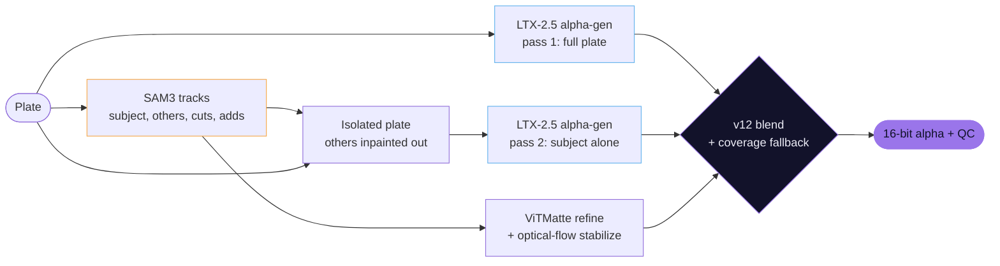

<div align="center">


by **Rikin Patel** · [Comfy Compositing](https://comfycompositing.com)

SAM3 decides *what* to matte. LTX-2.5 alpha-gen decides *how the edge looks*.


</div>


<sub>Task: matte the middle kid only. **LTX alpha-gen alone** has perfect hair but mattes all three kids, and there is no way to tell it which one. **SAM3** and **ONYX-style** pick the right kid but lose the strands. **Comfy Pro Alpha Generator** does both. Top: matte over checker. Below: hair zoom as alpha, then comped over green.</sub>

---

<sub><code>// 01 · problem</code></sub>

## The problem

Rotoscoping one person out of a crowd is still the most manual job in compositing. The AI tools split into two camps,
and each one is missing half of the answer:

| | Picks *which* subject | Edge quality | Why |
|---|:---:|:---:|---|
| **LTX-2.5 alpha-gen** (generative) | no | hair-level | Renders the matte jointly over the whole clip, but mattes *every* main subject and can't be told which one. |
| **SAM3 / ONYX-style** (discriminative) | yes | soft, per-frame | Tracks any object you point at, then *measures* the edge frame by frame with ViTMatte. Strands get lost; edges chatter. |
| **Comfy Pro Alpha Generator** | **yes** | **hair-level** | SAM3 steers, LTX draws. Built from both. |

<sub><code>// 02 · results</code></sub>

## Results

Measured on a 247-frame plate (three kids, arms around each other), matting only the middle kid.
Every method gets the same SAM3 selection.

<p align="center"></p>

| Method | Selects one subject | Edge detail match | Hair outside the SAM3 outline | Flicker vs LTX alone |
|---|:---:|:---:|:---:|:---:|
| LTX alpha-gen alone | no (mattes everyone) | 100% *(reference)* | 100% | 1.0x |
| SAM3 mask | yes | 29.4% | 0% | 2.6x |
| ONYX-style: SAM3 + ViTMatte | yes | 45.0% | 31.3% | 1.7x |
| ONYX-style + temporal stabilizer | yes | 46.1% | 31.8% | **0.5x** |
| **Comfy Pro Alpha Generator** | **yes** | **88.7%** | **88.7%** | 1.2x |

**How to read it**
- **Hair:** its edge matches LTX's generative hair at 88.7% while matting one subject only. The ViTMatte route
  reaches 45%: it keeps a soft halo but not the strands, and a SAM3 mask reaches 29% (see the zoom above).
- **Stability:** against background, it flickers the same as LTX alone (0.0112 vs 0.0109 mean error per
  pixel). The extra 0.2x comes from the few pixels where the subject touches someone else.
- **Honest trade-off:** a temporally stabilized ViTMatte matte is *steadier* than LTX (0.5x), because it is smooth
  and has no strands left to move. Alpha Generator trades that for real hair detail.

<details>
<summary><b>Methodology</b></summary>

- **Flicker** is motion compensated: each frame is predicted from its neighbours warped by DIS optical flow on the
  plate, and only the subject's outline band where the flow explains the plate (no occlusion) is scored. Plain
  frame-to-frame differences punish sharp edges that move, so they are not used.
- **Edge detail match** compares each matte with LTX's soft alpha (0.02 to 0.9) on the pixels nearer the subject
  than any other person: `1 - sum|matte - LTX| / sum(LTX)`. Filling in the gaps between strands and missing strands
  both count as error. **Hair outside the SAM3 outline** is the share of LTX's soft alpha beyond the SAM3 mask that
  a method recovers (a hard mask scores 0% by definition). Both use LTX as the reference, so they favour LTX-based
  methods; the hair zoom shows the same difference visually.
- An earlier version of this table used "hair kept", the plain sum of each matte over those pixels (SAM3 85.2%,
  ONYX-style 90.8%, this node 97.8%). It gave a solid mask credit for filling the gaps between strands, so it
  hid most of the difference and was replaced.
- **ONYX-style** is an emulation of ONYX Ai Matte v3's published pipeline (SAM3, then a trimap with erode 10 /
  dilate 15, then ViTMatte, per frame), plus this node's optical-flow stabilizer for the "+ stabilizer" row.
  The commercial ONYX plugin itself was not tested.
- Script: `measure_matte.py` logic, also built into the node as the QC badges.

</details>

### Any subject

<p align="center"></p>

Type a word (`dog`, `red car`, `bike`) or click anything in the frame. The others are excluded automatically,
including the same class: the white dog out of four, the bike without its rider.

---

<sub><code>// 03 · method</code></sub>

## How it works



**The key ideas**

1. **The isolated plate.** LTX can't be told which subject to matte, so the node changes what LTX *sees*. SAM3
   finds every other subject, and they are painted out with an **inpainted background** (a flat colour fill gets
   read as a half-transparent object). LTX then mattes the subject alone and draws every one of its edges itself,
   including parts SAM3 missed.
2. **Each tool where it is strong.** Against background, LTX's edge wins. Where the subject overlaps another person,
   LTX outputs 1.0 on both sides, so there is *no* edge information there. Within about 15 px of other subjects the
   node uses the stabilized ViTMatte edge; everywhere else, LTX.
3. **Coverage fallback.** LTX only mattes what it reads as a main subject. A per-area coverage map (1/8 res,
   temporally smoothed) finds the parts of the selection LTX left empty (a parked car, a table) and fills them with
   the ViTMatte matte, while the parts LTX did matte keep LTX edges.
4. **Temporal stability by construction.** LTX renders 49 frames jointly. SAM3 and ViTMatte decide per frame, so
   their outputs are smoothed with optical-flow-warped neighbours before blending. Long shots are rendered in
   overlapping chunks and cross-faded; the joins measure steadier than the rest of the shot.
5. **One node, a real graph.** On Queue, the node expands into a full ComfyUI graph of SAM3, ViTMatte and LTX stages.
   Each stage is cached, so switching Fast/Best or running the full shot after a preview reuses finished work.

<details>
<summary><b>Engineering notes</b></summary>

- **Speed:** LTX runs with Comfy Kitchen int8 attention: 36% faster sampling (5.09 to 3.25 s/step), edge change
  0.004, which is 7x smaller than changing the seed. Also benchmarked: Sage attention (same speed, but needs a
  per-machine wheel), Flash attention (no gain), block-sparse attention (changed the matte like a new seed) and
  torch.compile (crashes on int8 weights).
- **No text encoder:** alpha-gen uses an empty prompt, so its conditioning ships with the pack (24 KB, captured inside
  ComfyUI so it is bit-identical). That removes a 13 GB download and its RAM.
- **Memory:** uint8 plates, float16 masks, alpha-only VAE decode and per-frame blending took peak RAM from 48.5 to
  39.9 GB. Disk streaming then halves it again (below).
- **Bit-exact verification:** every memory change was diffed against the previous output. One change rounded the
  isolated plate's colours by a single 8-bit level, and LTX turned that into a visibly different sample (0.012 edge
  difference). Inputs to the generative pass now stay at full precision; result: identical mattes.

</details>

---

<sub><code>// 04 · usage</code></sub>

## Using it

<p align="center"></p>

1. Open `example_workflow.json` (video) or `example_sequence_workflow.json` (image sequence), or wire it yourself:

   | Plate | Wiring |
   |---|---|
   | **Video** | Load Video → Get Video Components → `images` + `fps` |
   | **Image sequence** | **Load Plate Sequence** → `images` + `fps` + `first_frame` |

   **Load Plate Sequence** reads a folder (`D:/plates/sh010`) or a pattern (`plate.####.exr` or `plate.%04d.exr`).
   PNG, JPG, TIF and EXR (scene-linear, converted to sRGB). `first` / `last` set the range, and output frames keep
   the plate's numbers: `plate.1001` gives `alpha_01001`.

   Any nodes can sit in between (crop, resize, colour). **Best quality at 1920x1088** (1920x1080 is padded
   automatically): LTX alpha-gen is tuned for that size. For 4K plates, matte a 1080p proxy and scale the alpha up.
The node walks you through three steps (**Plate → Subject → Render**); it only shows the next action.

2. **Plate.** Click the big **Load plate** button. It runs the nodes feeding `images` and fills the scrubber.
3. **Subject.** Scrub to a frame where the subject is fully visible and **click it**. It turns orange; every other
   person or object the click finds is excluded. Shift-click more objects to add them: the man, his glass and the
   table give one matte. Hard to click? Type it in **Find** (top right of the viewer):

   | Type | Finds |
   |---|---|
   | `person` (default) | every person |
   | `dog`, `red car`, `bike`, `woman` | any SAM3 concept |
   | `dog, person` | both: also paints out the people near a dog |

4. Fix parts if needed, on the first frame the part appears (tracking runs forward):

   | Action | What it does |
   |---|---|
   | **Alt-click** | **Cut** a part: someone else's hand on the subject |
   | **Shift-click** | **Add** a part: the subject's own hand that SAM3 missed |
   | **Ctrl-click** | Remove a cut or add marker |

5. **Render.** **Preview 49 frames** first (a few minutes). The result opens on the alpha; drag to wipe it
   against the plate, **Show comp** for the comp.
6. **Render full shot.** The alpha is saved to `ComfyUI/output/<filename_prefix>/alpha_00001.png …`,
   16-bit PNG by default or half-float EXR.

| Quality | What it does |
|---|---|
| **Best (v12)** | 2 LTX passes, the second on the isolated plate. |
| **Fast (v7)** | 1 LTX pass. About half the time; edges against other subjects are a little weaker. |

**QC badges** (after each run)

| Badge | Meaning | Green when |
|---|---|---|
| flicker | Motion-compensated flicker vs LTX alone | ≤ 1.3x |
| detail match | How closely the edge matches LTX's hair, fur and dust | ≥ 80% |
| LTX cover | How much of the subject LTX matted (the rest uses ViTMatte) | ≥ 90% |

`⚙ Advanced`: frames per chunk, overlap frames, seed, temporal smoothing, trimap erode/dilate, the zone near other
subjects, SAM3 threshold, `fast_attention` and the optional text encoder. Hover any model selector for the
recommended file and folder; press **R** after adding models. A missing model shows as `MISSING: <file>`, and the
run stops with the download link instead of failing halfway.

---

<sub><code>// 05 · hardware</code></sub>

## Hardware

**Which setup do I need?** Same example workflow for everyone; only these change:

| Your machine | What to do |
|---|---|
| 24 GB+ VRAM, 64 GB+ RAM | Nothing. Use the defaults. |
| 12 to 24 GB VRAM | Nothing. ComfyUI streams the model to the GPU (tested with 12 GB free, about 5% slower on the same card). |
| 16 to 48 GB RAM | Keep the models on an **NVMe SSD** (ComfyUI then streams them from disk by itself), or add `--fast-disk` to ComfyUI's launch arguments. Split very long shots. |
| Short on disk space | Optional: pick `LTX-2.5-Distilled-Q4_K_M.gguf` (15 GB) in `LTX-2.5 model`. Needs [ComfyUI-GGUF](https://github.com/city96/ComfyUI-GGUF); uses more RAM and is about 30% slower. |

<p align="center"></p>

**12 GB+ VRAM, 16 GB+ RAM.** ComfyUI 0.38+ streams the 22B LTX weights to the GPU as needed (dynamic VRAM), so small
GPUs work. The weights then wait in system RAM, about 24 GB, unless ComfyUI also streams them from disk.

**Disk streaming is the low-RAM switch.** It turns on by itself when the model sits on a fast NVMe SSD; on other
drives add `--fast-disk` to ComfyUI's launch arguments. The log line `Model storage policy: fast_disk=True` confirms it.

| Setup (dogs preview, 49 frames, Best, RTX 5090) | Peak RAM | Time | Matte |
|---|---|---|---|
| Model in RAM | 40 GB | | reference |
| Disk streaming | 21 GB | 272 s | identical |
| Disk streaming, machine squeezed to **16 GB** | fits | 333 s | identical |
| 12 GB of VRAM free (simulated) | | about 5% slower | identical |

<sub>Times from a fresh start, model loading included. The 16 GB test locked the rest of a 128 GB machine's RAM so the
OS could not use it. A real 12 GB card is slower from compute, not memory. Long shots need more working memory and
were not squeeze-tested.</sub>

**GGUF (optional).** With [ComfyUI-GGUF](https://github.com/city96/ComfyUI-GGUF) installed, `.gguf` files appear in the
model list, e.g. `LTX-2.5-Distilled-Q4_K_M.gguf` (15 GB, [realrebelai/LTX-2.5_GGUFs](https://huggingface.co/realrebelai/LTX-2.5_GGUFs)).
Use it only to save disk space: GGUF can't be streamed from disk, so it needs *more* RAM (27 vs 21 GB) and runs about
30% slower. Edge difference 0.05; it looks the same.

<sub><code>// 06 · install</code></sub>

## Install

**Requirements**

| | |
|---|---|
| ComfyUI | 0.38 or newer |
| GPU | NVIDIA, 12 GB+ VRAM (developed on an RTX 5090) |
| RAM | 16 GB+ with the models on an NVMe SSD, otherwise 64 GB (see [Hardware](#hardware)) |
| Disk | about 28 GB for the models |
| Node packs | [ComfyUI-SAM3](https://github.com/PozzettiAndrea/ComfyUI-SAM3), [ComfyUI-LTXVideo](https://github.com/Lightricks/ComfyUI-LTXVideo) |
| Python packages | `opencv-python-headless`, `transformers`, `huggingface_hub`, `av` (installed by step 1) |
| Account | free [Hugging Face](https://huggingface.co) account, to accept the LTX model license |

**1. Install this node pack.** Easiest: ComfyUI Manager > **Install via Git URL** > paste
`https://github.com/rik-python/ComfyUI-Comfy-Pro-Alpha-Generator.git` (it installs the Python packages too).
Or by hand, from a terminal **inside `ComfyUI/custom_nodes`** (ComfyUI's own Python environment active):
```
cd ComfyUI/custom_nodes
git clone https://github.com/rik-python/ComfyUI-Comfy-Pro-Alpha-Generator.git
pip install -r ComfyUI-Comfy-Pro-Alpha-Generator/requirements.txt
```
Restart ComfyUI afterwards.

**2. Required node packs** (ComfyUI Manager can install both):
- [ComfyUI-SAM3](https://github.com/PozzettiAndrea/ComfyUI-SAM3)
- [ComfyUI-LTXVideo](https://github.com/Lightricks/ComfyUI-LTXVideo)

**3. Get access to the LTX models.** The two Lightricks repos are gated:
1. Make a free [Hugging Face](https://huggingface.co) account.
2. Open [Lightricks/LTX-2.5](https://huggingface.co/Lightricks/LTX-2.5) and
   [Lightricks/LTX-2.5-22b-IC-LoRA-Alpha-Gen](https://huggingface.co/Lightricks/LTX-2.5-22b-IC-LoRA-Alpha-Gen),
   and accept the terms on each page.
3. Download in the browser while logged in, or log in once for the command line: `hf auth login`.
   (The Lightricks file links below show an access error until you are logged in and have accepted the terms.)

**4. Download the models.**

| # | File | Size | Download | Put it in |
|:-:|---|--:|---|---|
| 1 | `ltx-2.5-22b-distilled-transformer-comfy-int8-convrot.safetensors` | 21.5 GB | [Lightricks/LTX-2.5](https://huggingface.co/Lightricks/LTX-2.5/blob/main/diffusion_models/ltx-2.5-22b-distilled-transformer-comfy-int8-convrot.safetensors) | `models/diffusion_models/` |
| 2 | `ltx-2.5-22b-ic-lora-alpha-gen-0.9.safetensors` | 1.3 GB | [Lightricks/LTX-2.5-22b-IC-LoRA-Alpha-Gen](https://huggingface.co/Lightricks/LTX-2.5-22b-IC-LoRA-Alpha-Gen/blob/main/ltx-2.5-22b-ic-lora-alpha-gen-0.9.safetensors) | `models/loras/` |
| 3 | `ltx-2.5-video-vae-conv-bf16.safetensors` | 1.5 GB | [Lightricks/LTX-2.5](https://huggingface.co/Lightricks/LTX-2.5/blob/main/vae/ltx-2.5-video-vae-conv-bf16.safetensors) | `models/vae/` |
| 4 | `ltx-2.5-audio-vae-bf16.safetensors` | 0.4 GB | [Lightricks/LTX-2.5](https://huggingface.co/Lightricks/LTX-2.5/blob/main/vae/ltx-2.5-audio-vae-bf16.safetensors) | `models/vae/` |
| 5 | `sam3.safetensors` | 3.5 GB | **automatic** on first run ([apozz/sam3-safetensors](https://huggingface.co/apozz/sam3-safetensors)) | `models/sam3/` |
| 6 | ViTMatte `vitmatte-base-composition-1k` | 0.4 GB | **automatic** on first run ([hustvl/vitmatte-base-composition-1k](https://huggingface.co/hustvl/vitmatte-base-composition-1k)) | `models/vitmatte/vitmatte-base-composition-1k/` |

> **Use the conv video VAE (#3)**, `...-video-vae-conv-bf16`, not `...-video-vae-bf16`: only the conv VAE can encode
> the plate that guides alpha-gen. **No text encoder needed**: the pack ships the empty-prompt conditioning
> (the option sits under ⚙ Advanced; leave it on *built-in*).

<details>
<summary><b>Optional files</b></summary>

| File | Size | Download | Put it in | When |
|---|--:|---|---|---|
| `LTX-2.5-Distilled-Q4_K_M.gguf` | 15.1 GB | [realrebelai/LTX-2.5_GGUFs](https://huggingface.co/realrebelai/LTX-2.5_GGUFs/blob/main/LTX-2.5-Distilled-Q4_K_M.gguf) | `models/diffusion_models/` | Short on disk space (needs [ComfyUI-GGUF](https://github.com/city96/ComfyUI-GGUF)) |
| `gemma4-12b-with-proj-ltx-2.5-comfy-int8-convrot.safetensors` | 15.4 GB | [Lightricks/LTX-2.5](https://huggingface.co/Lightricks/LTX-2.5/blob/main/text_encoders/gemma4-12b-with-proj-ltx-2.5-comfy-int8-convrot.safetensors) | `models/text_encoders/` | Never required (built-in prompt gives the same result) |

</details>

**Folder structure** when done:

```
ComfyUI/
├── custom_nodes/
│   ├── ComfyUI-Comfy-Pro-Alpha-Generator/   <- this repo
│   ├── ComfyUI-SAM3/
│   └── ComfyUI-LTXVideo/
└── models/
    ├── diffusion_models/
    │   └── ltx-2.5-22b-distilled-transformer-comfy-int8-convrot.safetensors
    ├── loras/
    │   └── ltx-2.5-22b-ic-lora-alpha-gen-0.9.safetensors
    ├── vae/
    │   ├── ltx-2.5-video-vae-conv-bf16.safetensors
    │   └── ltx-2.5-audio-vae-bf16.safetensors
    ├── sam3/
    │   └── sam3.safetensors                 (downloads itself)
    └── vitmatte/
        └── vitmatte-base-composition-1k/    (downloads itself)
```

<details>
<summary><b>Download everything from the command line</b></summary>

Run inside `ComfyUI/models` after `hf auth login`. `--local-dir` keeps the repo's subfolders, so the files land in
the right folders:

```
hf download Lightricks/LTX-2.5 diffusion_models/ltx-2.5-22b-distilled-transformer-comfy-int8-convrot.safetensors vae/ltx-2.5-video-vae-conv-bf16.safetensors vae/ltx-2.5-audio-vae-bf16.safetensors --local-dir .
hf download Lightricks/LTX-2.5-22b-IC-LoRA-Alpha-Gen ltx-2.5-22b-ic-lora-alpha-gen-0.9.safetensors --local-dir loras
```

</details>

Models already in a subfolder (`models/diffusion_models/LTX/...`) work too: the node finds them by file name.
Press **R** in ComfyUI after adding files. **Low-RAM tip:** keep `models/` on an NVMe SSD (see [Hardware](#hardware)).

<sub><code>// 07 · limits</code></sub>

## What it can and can't do

| Spec | Value |
|---|---|
| Best resolution | **1920x1088** (a 1920x1080 plate is padded automatically). LTX alpha-gen is tuned for this size. |
| Other sizes | Work, but edges get softer; at half resolution the subject's alpha visibly drops. |
| 4K and up | Matte a 1080p proxy and scale the alpha up. |
| Shot length | Up to 24 chunks, about **960 frames** at the default settings. Split longer shots. |
| Frame range | From the frame you pick on to the end of the plate; earlier frames come out empty. |
| Speed (RTX 5090, Best) | 49-frame preview about 4 min; a 247-frame shot about 25 min. |
| Output | Alpha as 16-bit PNG or half-float EXR, plate frame numbers kept (`plate.1001` gives `alpha_01001`). |
| Subjects | One matte per run; it can stack several objects (a man, his glass and the table). |

| Works well | Works with care | Doesn't work (yet) |
|---|---|---|
| People, hair, animals with fur, vehicles with dust, props | A hand or arm crossing another person: the edge between them comes from SAM3/ViTMatte, so it is softer | Frames before the pick frame |
| Busy shots with several people (the others are painted out) | Background objects (a parked car): LTX mattes what it reads as the main subject; the **LTX cover** badge goes red and ViTMatte takes over | A subject fully hidden mid-shot (a car driving in front): SAM3 can lose the track. Pick after the occlusion or split the shot |
| Video files and EXR/PNG/TIF sequences | More than 8 other subjects near the target: only the nearest 8 are painted out (each costs about 14 s) | Despill: light hair fringes are plate colour spill. Despill in comp |
| 12 GB VRAM, 16 GB RAM machines (slower) | | |

**Not tested yet:** plates smaller than 1080p, vertical video, heavy motion blur, AMD and Apple GPUs.

<sub><code>// 08 · credits</code></sub>

## Credits

Built on [LTX-2.5 and the IC-LoRA Alpha-Gen](https://huggingface.co/Lightricks/LTX-2.5-22b-IC-LoRA-Alpha-Gen) by
Lightricks, [SAM3](https://github.com/facebookresearch/sam3) by Meta,
[ViTMatte](https://huggingface.co/hustvl/vitmatte-base-composition-1k) by HUST Vision Lab,
[ComfyUI-SAM3](https://github.com/PozzettiAndrea/ComfyUI-SAM3) and [ComfyUI](https://github.com/comfyanonymous/ComfyUI).
ONYX Ai Matte is a product of its respective owner; it is referenced here only as a design comparison.

**Author: Rikin Patel**, VFX compositor (Nuke) and ComfyUI educator at [Comfy Compositing](https://comfycompositing.com).
Designed for real compositing work: one subject, plate-accurate frame numbers, 16-bit/EXR output, measurable QC.

<sub><code>// 09 · license</code></sub>

## License

**Free for personal and non-commercial use** under the [PolyForm Noncommercial License 1.0.0](LICENSE).
**Commercial use** (paid client work, studio or company use, or inside a commercial product or service) needs a
commercial license: [comfycompositing.com/contact](https://comfycompositing.com/contact).

The license covers this node pack's code. The models it runs (LTX-2.5 and its IC-LoRA, SAM3, ViTMatte) and the node
packs it depends on have their own licenses; follow those as well.
